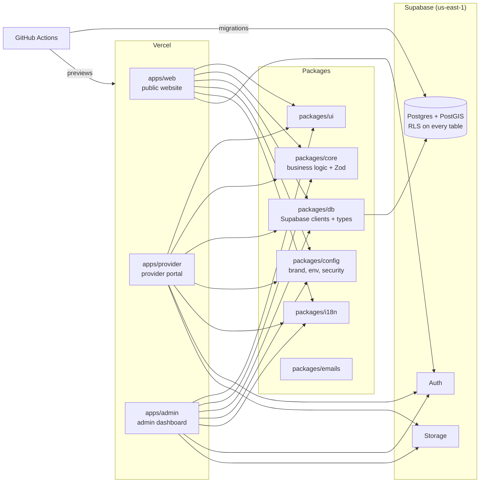

# RSOS

A US roadside assistance marketplace. A stranded driver shares their location and problem, gets
quotes with price and ETA from nearby verified providers within about 3 minutes, and picks one.
Drivers pay providers directly; providers pay a flat fee per picked request from a prepaid wallet,
plus optional Pro and Featured plans. Every request, provider, price, fee, phone number and page
belongs to a **market** (a metro area) stored in the database. The brand name and domain are
working values that live only in `packages/config` (see `CLAUDE.md`).

## Architecture

## Environments

| Environment | Git branch    | Apps                                               | Database       |
| ----------- | ------------- | -------------------------------------------------- | -------------- |
| Preview     | any PR branch | Vercel preview links (one per app)                 | `rsos-dev`     |
| Staging     | `staging`     | `staging.`, `staging-pro.`, `staging-admin.` hosts | `rsos-staging` |
| Production  | `main`        | apex, `www.`, `pro.`, `admin.` hosts               | `rsos-prod`    |

There is no local database: migrations are applied by CI (see `CLAUDE.md`, rule 4a).
Environment variables per app: [`docs/ENVIRONMENT.md`](docs/ENVIRONMENT.md).

## Get started (about one hour)

1. **Request access** (open an "Onboarding" issue from the issue templates): GitHub (write),
   Vercel team (member), Supabase organization (developer), Sentry and PostHog (when set up).
2. **Install:** Node from `.nvmrc` (`fnm install && fnm use`), then `corepack enable` or
   `npm i -g pnpm@<version in package.json>`, then `pnpm install`.
3. **Run:** copy `apps/<app>/.env.example` to `apps/<app>/.env.local` (values from
   `vercel env pull` once you have Vercel access), then `pnpm dev` (ports 3000, 3001, 3002).
4. **Pick a ticket** from the "RSOS Backlog" board, create `rsos-<id>-<slug>` from `staging`,
   build, run `pnpm lint && pnpm typecheck && pnpm test && pnpm build`.
5. **Open a pull request** into `staging` titled `RSOS-<id>: <title>`. Vercel posts preview links;
   the required checks (`docs/QA.md`) must pass; fill in the Gate 2 checklist; squash-merge.

## Work with Claude Code in the cloud

Open the repository at claude.ai/code (or run `claude` in a terminal in this folder) and start a
session on a branch from `staging`. Claude reads `CLAUDE.md` automatically; give it the ticket
text and ask it to open a pull request into `staging`. Cloud sessions need no local setup.

## Key documents

- `CLAUDE.md`: rules every change must follow (multi-market, no hardcoded brand, Zod, RLS, a11y)
- `CONTRIBUTING.md`: workflow, branches, commits, reviews, adding a migration or a market
- `docs/QA.md`: the four QA gates and how to read failures
- `SECURITY.md`: reporting, secrets and key rotation
- `docs/decisions/`: architecture decision records
- `docs/batches/`, `docs/reports/`: ticket specs and run reports
